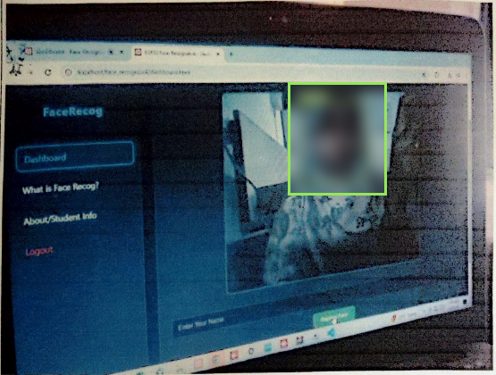
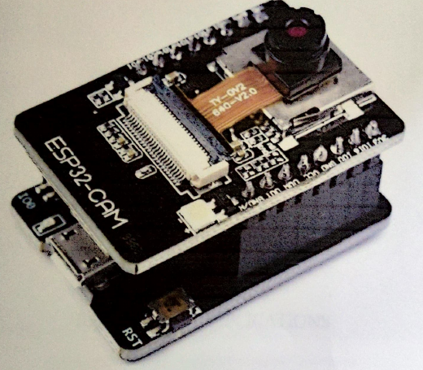
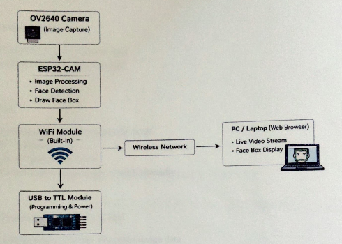
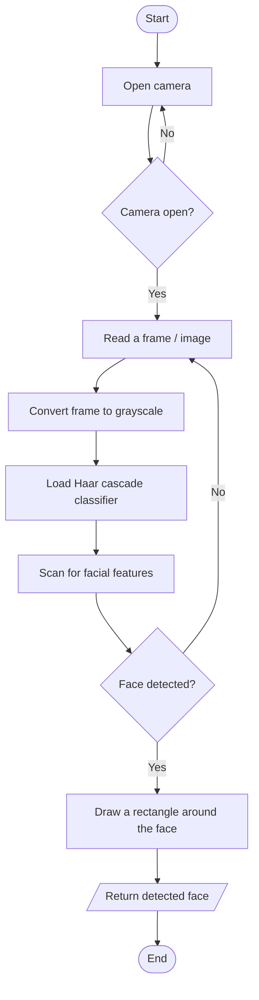

# ESP32-CAM Face Recognition System


[](https://whimsical-strudel-0f2465.netlify.app/)


A low-cost face recognition system built around the **ESP32-CAM** module, with a browser dashboard to register and recognise faces in real time.

**Institute:** Government Polytechnic, Solapur · **Branch:** Electronics & Telecommunication Engineering · **Year:** 2025–26

<p align="center">
  
  <br/><i>Final output: a registered face recognised on the dashboard</i>
</p>

---

## 📌 Overview

Traditional security and attendance systems suffer from duplication, manual errors and lack of automation. This project builds a compact, low-cost alternative using the ESP32-CAM, which combines an ESP32 microcontroller, a camera and Wi-Fi on a single board. The system detects faces in a live video feed, compares them with registered faces and shows the person's name on screen.

## 🎯 Objectives

- Develop a real-time face recognition system using the ESP32-CAM
- Detect and recognise human faces accurately
- Support login / logout recording for attendance
- Enhance security using biometric authentication
- Create a low-cost and efficient solution

## ✨ Features

- ESP32-CAM firmware that initialises the camera, connects to Wi-Fi and prints its IP address on the Serial Monitor
- Web dashboard (HTML, CSS, JavaScript) with live video and face detection
- Register a new face by typing a name and clicking **Capture & Save**
- Recognised faces get a **green box with the name**; unknown faces get a **red "Unknown" box**
- Registered faces are saved in the browser (`localStorage`), so they survive a page reload

## 🧰 Hardware

<p align="center">
  
</p>

- ESP32-CAM module (AI-Thinker, OV2640 camera)
- USB-to-TTL (FTDI) module for programming and power
- PC / laptop with a web browser

## 💻 Software & Tools

- Arduino IDE with ESP32 board support and the `esp32cam` library
- Visual Studio (C++ desktop development) for the toolchain
- HTML / CSS / JavaScript with [face-api.js](https://github.com/justadudewhohacks/face-api.js) for detection, landmarks and recognition
- OpenCV and Python (Haar cascade face detection, as described in the report flowchart)

## 🧩 System Design

<p align="center">
  
</p>

1. The **OV2640 camera** captures the image.
2. The **ESP32-CAM** handles image processing, face detection and drawing the face box.
3. The built-in **Wi-Fi module** sends the video over the wireless network.
4. A **PC / laptop browser** shows the live video with the face box.
5. The **USB-to-TTL module** is used for programming and power.

### Detection flow



## 📁 Project Structure

```
ESP32-CAM-Face-Recognition/
├── code/
│   └── esp32cam_server/
│       └── esp32cam_server.ino    # ESP32-CAM firmware (camera + Wi-Fi + server)
├── web/
│   ├── dashboard.html             # Face registration and recognition dashboard
│   └── style.css                  # Dashboard styling
├── images/                        # Diagrams and photos used in this README
├── docs/
│   └── Project_Report_Excerpt.pdf # Selected pages of the project report
└── README.md
```

## 🚀 How to Run

### 1. Program the ESP32-CAM

1. Install the `esp32cam` library: Arduino IDE → Sketch → Include Library → Add .ZIP Library.
2. Open `code/esp32cam_server/esp32cam_server.ino` and set your Wi-Fi name and password.
3. The sketch also needs `camera_pins.h` and `app_httpd.cpp` from the ESP32 **CameraWebServer** example (File → Examples → ESP32 → Camera). Copy them into the same folder.
4. Connect the ESP32-CAM through the USB-to-TTL module and short **IO0** to **GND**.
5. Select the board, click upload, and press **RESET** if the console shows dots and dashes.
6. After upload, remove the IO0–GND connection and press **RESET** again.
7. Open the Serial Monitor at **115200** baud. It prints `Use this IP: ...` once connected.

### 2. Open the dashboard

1. Serve the `web/` folder from a local server (for example, XAMPP, or `python -m http.server` inside `web/`) and open `http://localhost/.../dashboard.html`. Browsers allow camera access on `localhost`.
2. Allow camera access when asked and wait for **Models Loaded**.
3. Enter a name and click **Capture & Save** to register a face.
4. The face is now recognised in the live video with a green box and the name.

> **Note:** `dashboard.html` links to `info.html` and `about.html`, which are not part of this repository yet.

## 📊 Results

The dashboard detects faces in the live video and shows the registered name in a green box, as in the output screenshot above. Unregistered faces are shown as "Unknown" in a red box.

## 📄 Project Report

Selected pages of the project report: [`docs/Project_Report_Excerpt.pdf`](docs/Project_Report_Excerpt.pdf)

## 🔮 Future Scope

- Real-time face tracking in video streams
- Emotion recognition from facial expressions
- Privacy enhancements such as secure storage and anonymisation of facial data
- Integration with IoT and cloud services for remote monitoring and centralised management
- Customisation for attendance management and access control systems

## 👩‍💻 Author

**Munazza Hawaldar**
E&TC Diploma, Government Polytechnic, Solapur (2026)
[LinkedIn](https://www.linkedin.com/in/munazza-hawaldar-644b0041a/) · [Portfolio](https://whimsical-strudel-0f2465.netlify.app/)
